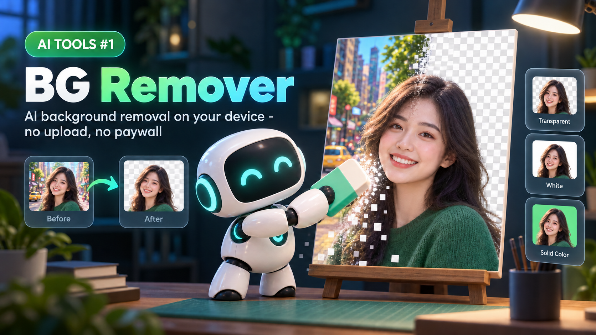
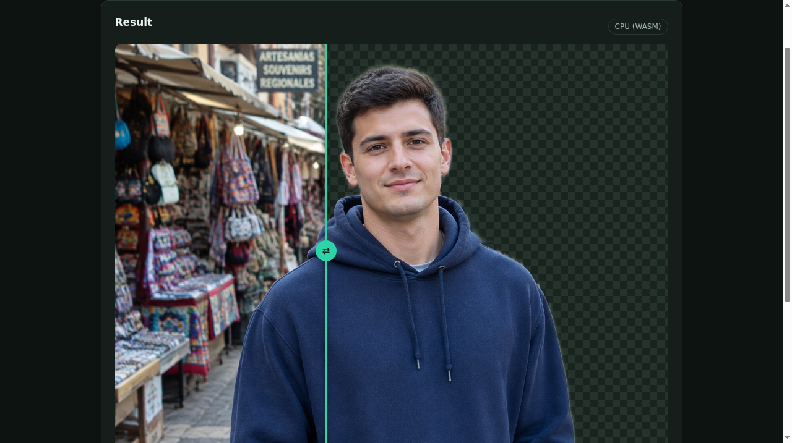

# BG Remover

Remove the background from photos of people and get a transparent PNG - with a real AI model that runs entirely on your device. No account, no upload, no paywall.


## Why this exists

Tools like remove.bg charge you or limit downloads, and every photo you try goes to someone else's server. This tool does the same job locally: the AI model downloads to your browser once, and your photos never leave your device.

## What it looks like



## What it does

- Drop, choose, or paste a photo (JPG, PNG, WebP).
- The AI model produces a clean cutout in seconds.
- Compare before/after with a slider.
- Pick a transparent, white, or custom-color background.
- Download the result as a PNG.

## The AI behind it

The model is **MODNet** ([ZHKKKe/MODNet](https://github.com/ZHKKKe/MODNet), Apache-2.0 license), a real-time portrait matting model, converted to ONNX by [Xenova](https://huggingface.co/Xenova/modnet) (Apache-2.0). It runs in your browser through [Transformers.js](https://huggingface.co/docs/transformers.js) using WebGPU when your browser supports it, or WASM (CPU) otherwise. No Python, no server, no API key.

Honest limits:

- MODNet is trained on **people**. Use it for portraits, profile pictures, and selfies. It is not made for products, animals, or objects.
- Fine details like loose hair are good but not perfect.
- The first visit downloads the model (about 6 MB). Your browser caches it, so later visits are fast and can work offline. The page itself and the model load from CDNs on first visit; your photos are never uploaded anywhere.

## Run it

**Easiest:** open `bg-remover.html` - a standalone single-file build that runs by double-clicking, no server needed (it loads the AI library and model from CDNs, so the first run needs internet).

**From source (the modular files):** serve the folder over HTTP, because browsers block loading separate ES modules from `file://`:

```bash
# from this folder, pick one:
npx serve .
python3 -m http.server 8000
```

Then open the printed local address (for example `http://localhost:8000`).

It also works hosted on any static host - GitHub Pages, Netlify, Cloudflare Pages - with zero configuration and zero server costs, because there is no backend.

## Tech

Plain HTML, CSS, and JavaScript. The only dependency is Transformers.js, pinned and loaded from a CDN. No tracking, no analytics, no cookies.

```text
bg-remover/
├── README.md
├── LICENSE
├── NOTICE
├── bg-remover.html   <- standalone single-file build
├── index.html        <- same app, modular source
├── styles.css
├── app.js
└── assets/
    ├── hero.png
    ├── demo.png
    └── screenshot.png
```

## License

Code: MIT - see [LICENSE](LICENSE).
Model: MODNet, Apache-2.0 (credits above). The MIT license covers this repository's code only.
